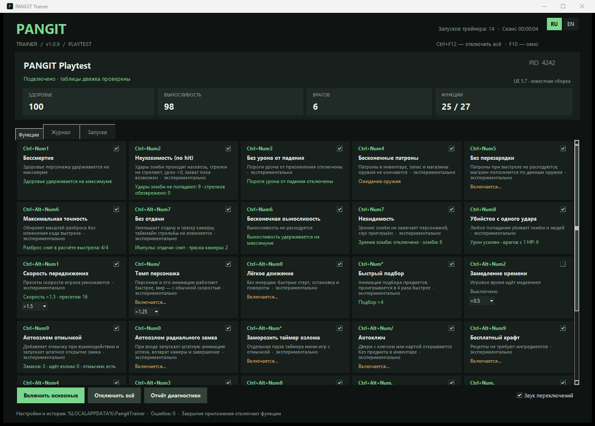
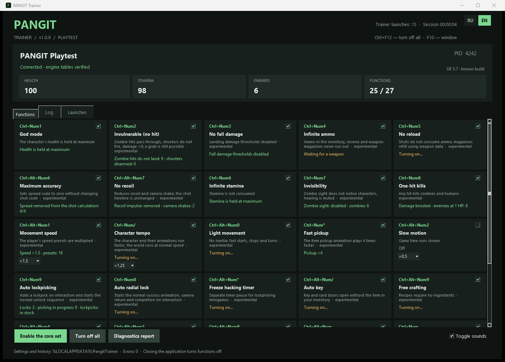

# PANGIT Trainer

[Русский](#русский) · [English](#english)

Трейнер для одиночной игры **PANGIT Playtest** (Windows x64, Unreal Engine 5.7). 27 функций, интерфейс на русском и английском с переключением на лету.



---

## Русский

### Что это

Внешняя программа, которая находит объекты игры через рефлексию Unreal Engine и меняет их значения в памяти процесса. Часть функций аккуратно правит байткод блюпринтов (например, убирает расход патронов или проверку наличия отмычки); при выключении функции исходные байты восстанавливаются с проверкой чтением.

Только для одиночной игры. Античита в PANGIT Playtest нет; трейнер не трогает защиту, сеть и файлы игры.

### Установка и запуск

1. Скачайте `PangitTrainer.exe` из [релизов](https://github.com/jestelf/PangitTrainer/releases).
2. Запустите игру и загрузите уровень.
3. Запустите трейнер — он сам найдёт процесс игры. Права администратора не нужны.
4. Включайте функции галочками или горячими клавишами.

Настройки, язык и журнал хранятся в `%LOCALAPPDATA%\PangitTrainer`. Закрытие трейнера отключает все функции.

### Горячие клавиши

`Ctrl+F12` — отключить всё · `F10` — показать/скрыть окно. Клавиши Num работают при любой раскладке.

| Клавиши | Функция | Что делает |
|---|---|---|
| Ctrl+Num1 | Бессмертие | Здоровье удерживается на максимуме |
| Ctrl+Num2 | Неуязвимость (no hit) | Удары зомби проходят насквозь, стрелки не стреляют, урон ×0; захват пока возможен |
| Ctrl+Num3 | Без урона от падения | Пороги урона от приземления отключены |
| Ctrl+Num4 | Бесконечные патроны | Патроны в инвентаре, запас и магазины не кончаются |
| Ctrl+Num5 | Без перезарядки | Выстрел не расходует патроны; магазин пополняется по данным оружия |
| Ctrl+Alt+Num6 | Максимальная точность | Масштаб разброса обнулён |
| Ctrl+Alt+Num7 | Без отдачи | Меньше отдачи и тряски камеры |
| Ctrl+Num6 | Бесконечная выносливость | Выносливость не расходуется |
| Ctrl+Num7 | Невидимость | Зрение зомби не замечает персонажей, слух приглушён |
| Ctrl+Num8 | Убийство с одного удара | Любое попадание убивает зомби и людей |
| Ctrl+Alt+Num1 | Скорость передвижения | Скорость ×1.5 / ×2 / ×3 |
| Ctrl+Num/ | Темп персонажа | Персонаж и его анимации быстрее, мир — с обычной скоростью |
| Ctrl+Alt+Num0 | Лёгкое движение | Без инерции: быстрые старт, остановка и повороты |
| Ctrl+Num* | Быстрый подбор | Анимация подбора в 4 раза быстрее |
| Ctrl+Alt+Num2 | Замедление времени | Время ×0.5 / ×0.25 / ×0.1 |
| Ctrl+Num9 | Автовзлом отмычкой | Отмычка выдаётся при взаимодействии, замок открывается штатной анимацией |
| Ctrl+Num0 | Автовзлом радиального замка | Сразу запускается штатная анимация успеха |
| Ctrl+Alt+Num* | Заморозить таймер взлома | Пауза таймера мини-игр с отмычкой |
| Ctrl+Alt+Num/ | Автоключ | Двери с ключом или картой (T1/T2) открываются без предмета |
| Ctrl+Alt+Num9 | Бесплатный крафт | Изученные рецепты не требуют и не списывают ингредиенты |
| Ctrl+Alt+Num4 | Деньги | Валюта удерживается на 999 999 |
| Ctrl+Alt+Num3 | Дрон: неуязвимость | Здоровье дрона не убывает |
| Ctrl+Alt+Num8 | Дрон без отката | Нет задержки вызова дрона и перезарядки навыков |
| Ctrl+Alt+Num. | Дрон без разрядки | Время работы дрона не убывает |
| Ctrl+Num. | Ресурсы дрона | Инъекторы, гранаты, дымовые гранаты и батареи дрона не кончаются |
| Редактор | Дрон: характеристики | Урон, здоровье, броня, скорость и дальность дрона |
| Ctrl+Alt+Num5 | Без голода и жажды | В демо голод и жажда отключены самой игрой; заработает, если появятся в полной версии |

«Включить основные» включает бессмертие, неуязвимость, отсутствие урона от падения, патроны, отсутствие перезарядки, выносливость, невидимость и убийство с одного удара.

### Поддерживаемая версия

PANGIT Playtest (Steam, appid 3886110), сборка `PANGIT_Demo-Win64-Shipping.exe` 2026-10. Трейнер проверяет таблицы движка при подключении и показывает, известна ли ему сборка. После обновления игры отдельные функции могут перестать находить нужный код — тогда они остаются в ожидании и ничего не пишут.

### Что проверено

- 31 автоматический тест: ветви функций, применение и точное восстановление патчей байткода, ошибки записи, переподключение, RU/EN и компоновка окна.
- Распознавание патчей сверено с байткодом установленной версии игры.
- Поведение в игре проверяет автор вручную. Функции с пометкой «экспериментально» могут работать не во всех ситуациях. Если что-то не срабатывает, нажмите «Отчёт диагностики» и приложите `%LOCALAPPDATA%\PangitTrainer\diagnostics.txt` к issue.

### Антивирусы

Exe собран PyInstaller и читает/пишет память другого процесса, поэтому некоторые антивирусы могут ругаться эвристически. Исходники открыты; exe можно собрать самостоятельно. SHA-256 файла указан в описании релиза.

### Сборка

Python 3.10+ (tkinter) и PyInstaller:

```powershell
python -m unittest discover -s tests -v
powershell -ExecutionPolicy Bypass -File build.ps1
```

Результат — `dist\<версия>\PangitTrainer.exe`. Запуск без игры для просмотра интерфейса: `python src\app.py --preview --lang=ru`.

### Лицензия

MIT. Проект не связан с разработчиками PANGIT.

---

## English



### What it is

An external trainer for the single-player **PANGIT Playtest** (Windows x64, Unreal Engine 5.7). It locates game objects through Unreal Engine reflection and changes their values in process memory. Some features carefully patch Blueprint bytecode (for example, removing ammo consumption or the lockpick check); when a feature is turned off, the original bytes are restored and verified by reading them back.

Single-player only. PANGIT Playtest has no anti-cheat; the trainer does not touch protection, networking or game files.

### Install and run

1. Download `PangitTrainer.exe` from [releases](https://github.com/jestelf/PangitTrainer/releases).
2. Start the game and load a level.
3. Start the trainer; it finds the game process by itself. Administrator rights are not required.
4. Toggle features with the checkboxes or hotkeys.

Settings, language and the log are stored in `%LOCALAPPDATA%\PangitTrainer`. Closing the trainer turns every feature off.

### Hotkeys

`Ctrl+F12` turns everything off · `F10` shows/hides the window. Num keys work with any keyboard layout.

| Keys | Feature | What it does |
|---|---|---|
| Ctrl+Num1 | God mode | Health is held at maximum |
| Ctrl+Num2 | Invulnerable (no hit) | Zombie hits pass through, shooters do not fire, damage ×0; a grab is still possible |
| Ctrl+Num3 | No fall damage | Landing damage thresholds disabled |
| Ctrl+Num4 | Infinite ammo | Inventory ammo, reserve and magazines never run out |
| Ctrl+Num5 | No reload | Shots do not consume ammo; magazines refill using weapon data |
| Ctrl+Alt+Num6 | Maximum accuracy | Spread scale set to zero |
| Ctrl+Alt+Num7 | No recoil | Less recoil and camera shake |
| Ctrl+Num6 | Infinite stamina | Stamina is not consumed |
| Ctrl+Num7 | Invisibility | Zombie sight does not notice characters, hearing is muted |
| Ctrl+Num8 | One-hit kills | Any hit kills zombies and humans |
| Ctrl+Alt+Num1 | Movement speed | Speed ×1.5 / ×2 / ×3 |
| Ctrl+Num/ | Character tempo | The character and their animations run faster, the world at normal speed |
| Ctrl+Alt+Num0 | Light movement | No inertia: fast starts, stops and turns |
| Ctrl+Num* | Fast pickup | Pickup animation plays 4 times faster |
| Ctrl+Alt+Num2 | Slow motion | Time ×0.5 / ×0.25 / ×0.1 |
| Ctrl+Num9 | Auto lockpicking | A lockpick is granted on interaction, the lock opens with the normal animation |
| Ctrl+Num0 | Auto radial lock | Starts the normal success animation right away |
| Ctrl+Alt+Num* | Freeze hacking timer | Pauses the lockpicking minigame timer |
| Ctrl+Alt+Num/ | Auto key | Key and card (T1/T2) doors open without the item |
| Ctrl+Alt+Num9 | Free crafting | Learned recipes neither require nor consume ingredients |
| Ctrl+Alt+Num4 | Money | Currency is held at 999,999 |
| Ctrl+Alt+Num3 | Drone: invulnerable | Drone health does not decrease |
| Ctrl+Alt+Num8 | Drone without cooldown | No delay for calling the drone or recharging its skills |
| Ctrl+Alt+Num. | Drone never drains | Drone operating time does not run down |
| Ctrl+Num. | Drone resources | Drone injectors, grenades, smoke grenades and batteries never run out |
| Editor | Drone: stats | Drone damage, health, armor, speed and range |
| Ctrl+Alt+Num5 | No hunger and thirst | Hunger and thirst are disabled by the demo itself; will work if they appear in the full game |

"Enable the core set" turns on god mode, no hit, no fall damage, ammo, no reload, stamina, invisibility and one-hit kills.

### Supported version

PANGIT Playtest (Steam, appid 3886110), `PANGIT_Demo-Win64-Shipping.exe` build from 2026-10. The trainer verifies engine tables when it connects and shows whether the build is known. After a game update some features may no longer find their code; they then stay waiting and write nothing.

### What is verified

- 31 automated tests: feature branches, applying and exactly restoring bytecode patches, write failures, reconnecting, RU/EN and window layout.
- Patch recognition was checked against the bytecode of the installed game version.
- In-game behavior is tested manually by the author. Features marked "experimental" may not work in every situation. If something does not work, press "Diagnostics report" and attach `%LOCALAPPDATA%\PangitTrainer\diagnostics.txt` to an issue.

### Antivirus

The exe is built with PyInstaller and reads/writes another process's memory, so some antivirus products may raise heuristic warnings. The source is open and you can build the exe yourself. The file's SHA-256 is listed in the release notes.

### Build

Python 3.10+ (tkinter) and PyInstaller:

```powershell
python -m unittest discover -s tests -v
powershell -ExecutionPolicy Bypass -File build.ps1
```

Output: `dist\<version>\PangitTrainer.exe`. To view the UI without the game: `python src\app.py --preview --lang=en`.

### License

MIT. Not affiliated with the developers of PANGIT.
